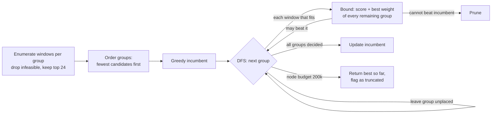
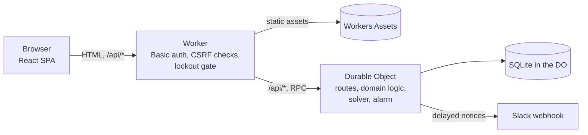

# Group Scheduler

[](https://github.com/nuummm/group-scheduler/actions/workflows/ci.yml)

A self-hosted web app for small organizations: collect everyone's availability, place all
recurring group sessions at once so that no two share a time slot, and show who is in the room.
Sessions are timetabled by a custom branch-and-bound solver (no external solver), checked against
exact oracles and benchmarked against a HiGHS MIP. It runs on Cloudflare Workers with a single
SQLite-backed Durable Object.

**Where to look first**

- [`src/lib/assignment.ts`](src/lib/assignment.ts) — the solver
- [`docs/assignment.md`](docs/assignment.md) — formulation, algorithm, verification
- [`docs/benchmark.md`](docs/benchmark.md) — solver vs. exact MIP on seeded random instances
- [`src/server/auth-guard.ts`](src/server/auth-guard.ts) — lockout after failed sign-ins

The UI is in Japanese. Organization name, the words used for "group" and "role", the weekly
slot grid and the default roles are deployment settings (see [Configuration](#configuration)).

## The problem

Scheduling for a small group usually means "find a time when everyone is free" — for one meeting.
The harder case is a set of **recurring sessions** (seminars, study groups, project meetings)
with overlapping memberships, all sharing one room and one person who runs them.

Picking the best slot for each session independently does not give a usable timetable: two
sessions can land in the same slot, and choosing a slot for one session changes what is left for
the others. So the app places **all groups at once** under one rule: **one group per cell**.
People who belong to several groups only change how many attendees a window gets; they are not
the reason two sessions may not overlap.

Other rules come from how the tool is used:

- a group can require a role (for example, the owner) to be free — a hard constraint, not a score;
- a group placed by hand (pinned, or dragged to a cell) is never moved by the solver.

## Formulation

For group $g$, a window $p$ is a run of $\ell_g$ consecutive slots in one column, $C(p)$ its
cells, and $w_{g,p}$ the number of members free for the whole window. Windows where a required
member is busy are dropped.

$$
\max \sum_{g,p} w_{g,p}\, x_{g,p}
\quad \text{s.t.} \quad
\sum_{p} x_{g,p} \le 1 \;\; \forall g, \qquad
\sum_{(g,p):\, k \in C(p)} x_{g,p} \le 1 \;\; \forall k, \qquad
x_{g,p} \in \{0,1\}.
$$

With all spans equal to 1 this is a maximum-weight bipartite matching; with mixed spans it is a
weighted job interval selection problem, NP-hard in general. Details:
[docs/assignment.md](docs/assignment.md).

## Algorithm



The search is anytime: if it hits the node budget it returns the best timetable found and the UI
says the result may not be optimal.

## Verification

**Oracle tests** ([`assignment.oracle.test.ts`](src/lib/assignment.oracle.test.ts)) re-enumerate
candidates independently of the app code and solve exactly:

- 200 random small boards (2–3 columns, 4–6 slots, 1–5 groups, spans 1–3) with a bitmask DP over
  occupied cells: the objective matches on all 200, both without limits and with the default node
  budget (the default top-24 candidate cut never binds on boards this small);
- the same 200 boards with the cut forced to 2 candidates per group: every group left unplaced
  has no free window left, i.e. the last pass over cut candidates works;
- 50 random 5 x 6 weekly boards with single-slot groups, with the Hungarian method: the objective
  matches on all 50 without limits; with the default limits (where the top-24 cut does bind), any
  shortfall comes with the truncation flag set;
- 200 random small boards with one group placed by hand, with the same DP started from the cells
  that group occupies: the objective matches on all 200, both without limits and with the defaults;
- every returned timetable is checked for shared cells, spans, required members and attendee lists.

**Benchmark** (`pnpm bench`, full table in [docs/benchmark.md](docs/benchmark.md); Node on an
Apple M5 laptop, not on Workers):

| instances | n | matched MIP optimum | max gap | node budget hit | B&B ms p50 / p95 | HiGHS ms p50 |
|---|---:|---:|---:|---:|---:|---:|
| weekly 5x6, 6 groups | 100 | 100% | 0 | 0% | 0.2 / 0.4 | 2.1 |
| weekly 5x6, 10 groups | 100 | 99% | 1 (1.5%) | 3% | 0.3 / 4.8 | 2.4 |
| weekly 5x6, 14 groups | 100 | 91% | 2 (2.5%) | 17% | 0.9 / 14.1 | 3.0 |
| range 20x10, 12 groups | 30 | 100% | 0 | 0% | 2.6 / 3.1 | 15.7 |
| range 40x10, 12 groups | 30 | 100% | 0 | 0% | 5.5 / 6.3 | 35.8 |
| range 61x10, 16 groups | 30 | 100% | 0 | 0% | 11.5 / 13.4 | 79.6 |

The solver runs with its default limits (node budget 200,000, top 24 candidates per group), so it
is an anytime search, not an exact method. HiGHS is there as the reference for optimality, not
as a speed baseline: it solves exactly, and its times include parsing the LP text, so the two
time columns are not a like-for-like comparison. Every instance with a gap had hit the node
budget; the benchmark has no hand-placed groups. The weak bound (it ignores conflicts) is the
main limitation on tight grids; see [Limitations](#limitations).

## Designed for daily use

- **Humans and the optimizer share one board.** Dragging a group to a cell or pinning it fixes it;
  the solver re-plans the rest around it. While dragging, only cells where every member is free
  and no other hand-placed group sits are highlighted. Conflicts between two hand-placed groups
  are shown, never silently resolved.
- **Undoable presence notifications.** Tapping a seat posts to Slack only after a short delay.
  The pending notice is a database row, flushed by a Durable Object alarm, so a mistaken tap can
  be undone before anything is sent, and arrivals within the delay are merged into one message.

  ```mermaid
  stateDiagram-v2
      [*] --> Pending: seat set to present
      Pending --> Pending: another arrival (merged, deadline pushed, capped)
      Pending --> Cancelled: undo / seat toggled back
      Pending --> Sent: alarm at send time
      Pending --> Dropped: far past send time
      Cancelled --> [*]
      Sent --> [*]
      Dropped --> [*]
  ```

- **Consistency.** All state lives in one Durable Object. Read-modify-write operations run in
  synchronous transactions, schedules carry a version number to detect concurrent edits, and read
  results are cached until the next write so that polling clients do not re-run the solver.
- **Access control.** One shared Basic-auth password guards every page and API (except a health
  check). The Worker fails closed if no password is set, rejects cross-site writes
  (`Content-Type` and `Sec-Fetch-Site` checks, because browsers attach remembered Basic
  credentials to cross-site form posts), and locks out a client address (an IPv6 client by its
  /64 prefix) for 15 minutes after 10 failed sign-ins within 10 minutes. While locked, every attempt gets 429, right password or
  not, so the response does not reveal a correct guess. Only failures are counted, so successful
  polling never uses up the allowance; but because the key is the client address, failures from
  one person behind a shared NAT lock out everyone behind it. Optional per-participant passwords
  (scrypt) are locked out per participant in the same way.
- **Privacy on the presence board.** Attendance "titles" (longest streak, most days this month)
  show only the top person and only above a threshold; day counts and rankings are never listed.

## Architecture



| path | role |
|---|---|
| `src/worker/` | entry Worker: authentication, cross-site checks, forwarding |
| `src/server/` | the Durable Object and everything that touches the database |
| `src/lib/` | pure logic shared by server and UI (solver, schedule grid, types) |
| `src/app/` | the React SPA (Vite) |
| `test/` | Worker and Durable Object tests, run on workerd |
| `bench/` | solver vs. HiGHS benchmark |

## Run locally

Requires Node.js 22.13+ (CI runs Node 24) and pnpm.

```bash
pnpm install
cp .dev.vars.example .dev.vars   # sets the local password: dev-password
pnpm dev                         # http://127.0.0.1:8000  (user: demo)
```

The dev server exits if port 8000 is taken; change `server.port` in `vite.config.ts` if needed.

An empty database starts with a demo event generated from a fixed seed (fictional members) and a
4 x 4 seat layout.

```bash
pnpm typecheck   # generates Worker types, then tsc -b
pnpm lint        # Biome
pnpm test        # Vitest: unit tests on Node, Worker/DO tests on workerd
pnpm build
pnpm bench       # solver vs. HiGHS (not run in CI)
```

## Configuration

Set in `vars` in [`wrangler.jsonc`](wrangler.jsonc) (or in `.dev.vars` locally).

| variable | default | meaning |
|---|---|---|
| `APP_NAME` | `Group Scheduler` | name in the header and tab title |
| `TERM_GROUP` | `グループ` | word for a group (e.g. ゼミ, 勉強会) |
| `TERM_ROLE` | `区分` | word for a role (e.g. 学年, 職位) |
| `OWNER_ROLE` | `リーダー` | the role every event has and that cannot be deleted; groups can require it |
| `DEFAULT_ROLES` | `メンバー` | comma-separated roles added to every new event |
| `WEEKLY_SLOTS` | six 90-minute periods from 9:00 | `label=start-end` or `start-end`, comma-separated |
| `WEEKDAYS` | `mon,tue,wed,thu,fri` | columns of the weekly mode |
| `PLACE_NAME` | `部屋` | name of the place in presence notifications |
| `SCHEDULER_BASIC_USER` | `demo` | Basic-auth user name |
| `SCHEDULER_TIME_ZONE` | `Asia/Tokyo` | time zone for dates and notifications |
| `SLACK_NOTIFY_DELAY_MS` | `5000` | undo window for presence notifications |
| `SLACK_BOT_NAME` | value of `APP_NAME` | sender name on Slack posts |

Secrets: `SCHEDULER_BASIC_PASSWORD` (required; without it every request gets 503) and
`SLACK_ATTENDANCE_WEBHOOK_URL` (optional). An event copies the slot grid and weekdays when it is
created, so changing them later does not shift existing events.

<details>
<summary>Deploying to your own Cloudflare account</summary>

```bash
pnpm exec wrangler login
# edit "name" and "vars" in wrangler.jsonc
pnpm run deploy                                         # build + wrangler deploy
pnpm exec wrangler secret put SCHEDULER_BASIC_PASSWORD
pnpm exec wrangler secret put SLACK_ATTENDANCE_WEBHOOK_URL   # optional
```

Use `pnpm run deploy`, not `pnpm deploy` (a different, built-in pnpm command). Until the password
secret is set, the deployed app answers 503 to everything. The SQLite-backed Durable Object used
here is available on the Workers free plan.
</details>

## Tech stack and tests

TypeScript, React 19, React Router, Zustand, Tailwind CSS 4, Vite, Zod, Cloudflare Workers and
Durable Objects (SQLite), Biome, Vitest with `@cloudflare/vitest-plugin`. HiGHS (`highs` on npm)
is a dev dependency used only by the benchmark.

134 tests: 106 unit tests on Node (solver, oracles, schedule grid, messages, password hashing,
demo data) and 28 Worker/Durable Object tests on workerd (authentication and lockout, routing,
events, presence notifications). CI runs typecheck, lint, tests and build on every push to
`main` and on pull requests.

## Limitations

- The objective is total attendance. It can prefer one large, partly attended group over two
  small, fully attended ones; a lexicographic objective would fit how people judge timetables.
- The bound ignores conflicts, so tight instances (14 groups on 30 cells) hit the node budget in
  17% of the benchmark runs. A matching-based bound would prune much more.
- Lockouts trade availability for resistance to guessing: anyone who knows the shared password
  can lock a participant out for 15 minutes by entering wrong participant passwords, and one
  client can lock out a whole shared NAT (or, over IPv6, everyone in the same /64).
- One shared password identifies nobody. For per-person access, put an identity-aware proxy such
  as Cloudflare Access in front.
- The UI is Japanese only.

## Background

I originally built this tool for a university research group. This repository is a rewrite of
it for general use: parts specific to that group were removed, the names, roles and timetable
became settings, and the lockout, oracle tests and benchmark were added.

## License

[MIT](LICENSE)

---

### 日本語の要約

小さな組織向けのセルフホスト型 Web アプリです。全員の空き予定を集め、定例やゼミなど複数のグループの開催枠を
「1 コマに 1 グループまで」の制約の下でまとめて決め（自作の分枝限定法）、在室状況も共有できます。
解は小さな問題での厳密解（動的計画法・ハンガリー法）と一致することをテストで確かめ、HiGHS による整数計画の
厳密解とも比較しています。Cloudflare Workers と Durable Objects（SQLite）で動きます。
